# The same workflow in the OpenShift AI dashboard

The six notebooks do every step in code. Many of the steps can also be done by clicking in the Red Hat OpenShift AI
dashboard, which helps platform and MLOps teams that would rather not work in notebooks. This page shows those
screens, step by step, in the order of the workflow.

Screenshots are from OpenShift AI 3.5 and our project, *Module 2 – Fine-tuning on OpenShift AI*. Your menus
match; your project and model names will differ.

| Step | In the dashboard | Still needs code |
|---|---|---|
| Project and workbench | Yes | |
| 01 Create data (SDG Hub) | Run it as a pipeline | Writing the flow (notebook 01) |
| 02 Choose a method | | Memory estimator (notebook 02) |
| 03 Fine-tune and post-train | Start a training pipeline, watch jobs | Writing the training code (notebook 03) |
| Track experiments | Yes, MLflow | |
| 04 Serve on vLLM | Yes, deploy wizard | Several LoRA adapters on one endpoint (notebook 04) |
| 05 Edge with llama.cpp | Deploy once the runtime is registered | 4-bit conversion (notebook 05) |
| Try the model | Yes, playground (Technology Preview) | |
| 06 Gate and promote | Yes, upload and run the pipeline | Writing the pipeline (notebook 06) |

---

## 1. Project and workbench

**Projects → your project → Overview.** One project holds the workbench, pipelines, experiments, deployments and
storage, with access controlled per project.

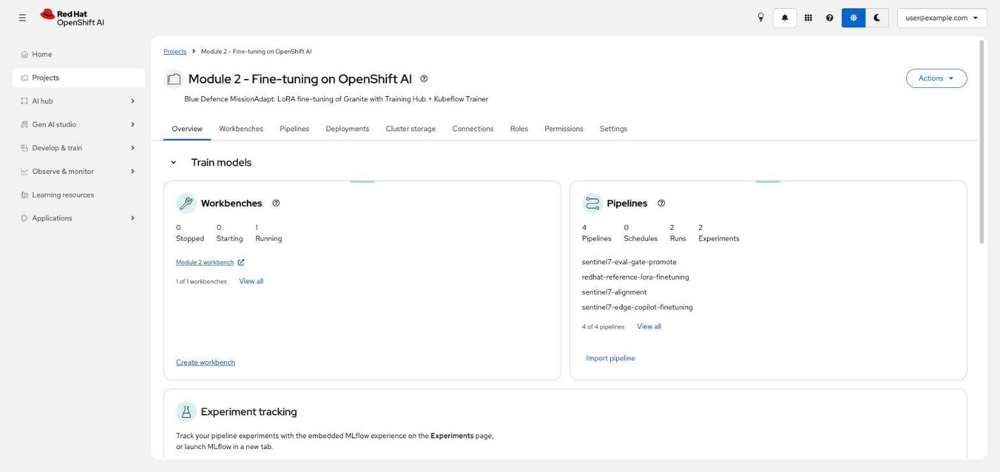

**Projects → your project → Workbenches → Create workbench.**

1. Name the workbench.
2. Image: **Training | Jupyter | PyTorch | CUDA | Python**. It ships Training Hub, the Kubeflow SDK and MLflow.
3. Hardware profile: a GPU profile for notebook 03 in the workbench, or a CPU profile if training runs as TrainJobs.
4. Cluster storage: **Attach existing storage** and pick the project volume at `/opt/app-root/src/workspace`.
5. **Create workbench**, then open it and clone this repository.

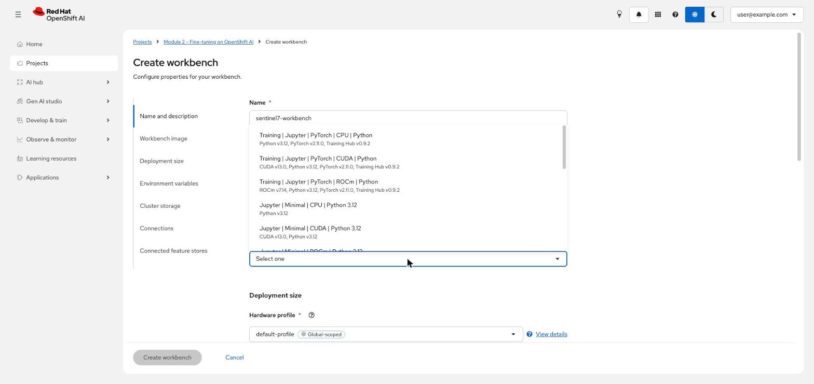

## 2. Create data and train from a form (pipelines)

Any step written once as a pipeline can be run again by anyone from a form, without opening a notebook.

**Develop & train → Pipelines → Pipeline definitions.** **Import pipeline** uploads a compiled pipeline YAML file.
The list below is from our project: one pipeline runs data preparation with SDG Hub, then Training Hub
`lora_sft`, a held-out evaluation, a quality gate, the MLflow registry and the 4-bit edge export.

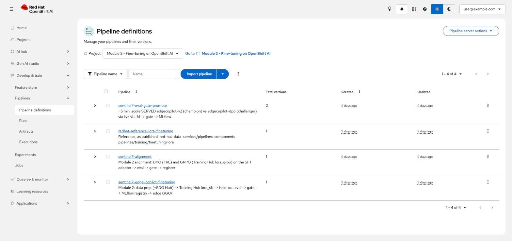

**⋮ → Create run** opens a form with the pipeline's settings: learning rate, LoRA rank and alpha, sequence length,
epochs, data paths, the teacher model for SDG Hub. Change a value and press **Create run**; there's no code to
edit. Tick **Enable MLflow experiment tracking** to log the run.

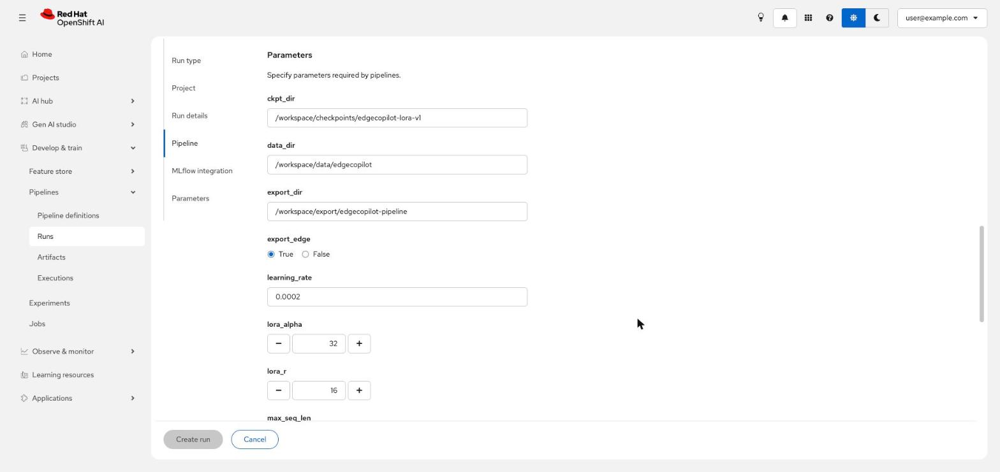

> This repository ships one pipeline, eval-gate-promote (section 6). The training pipeline shown above is from our
> project. To get the same form for your training, wrap the calls from notebooks 01 and 03 as pipeline steps the
> way notebook 06 does, and compile them to YAML.

**Watching training.** **Develop & train → Jobs** lists the TrainJobs (and RayJobs) in the project, including the
ones notebook 03 starts, with their progress.

## 3. Track experiments (MLflow)

**Develop & train → Experiments** opens MLflow inside the dashboard, scoped to the project. Every training and
evaluation run is listed with its duration and source.

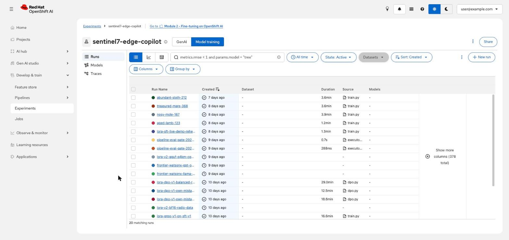

Open a run to see its metrics, tags and the registered model version it produced. This is the first fine-tune:
92.7% exact reports, registered as `sentinel7-edge-copilot` version 1.

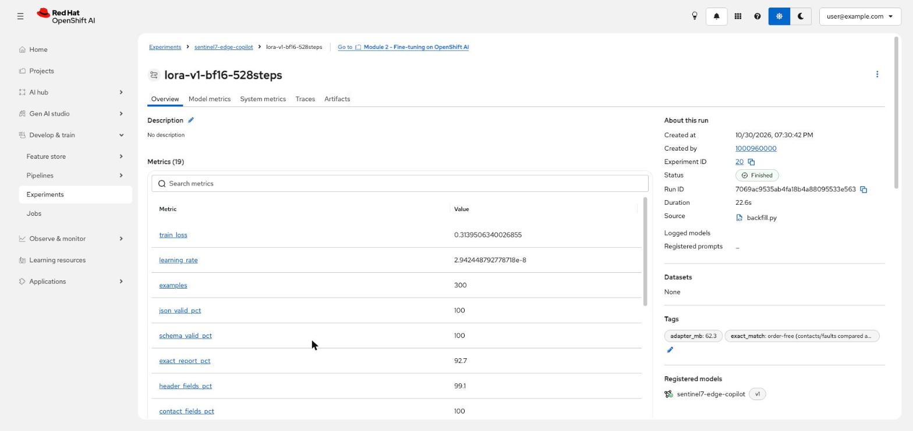

## 4. Serve on vLLM (deploy wizard)

**AI hub → Models → Catalog** lists models validated by Red Hat, including Granite, with benchmarks. You can deploy
one from here.

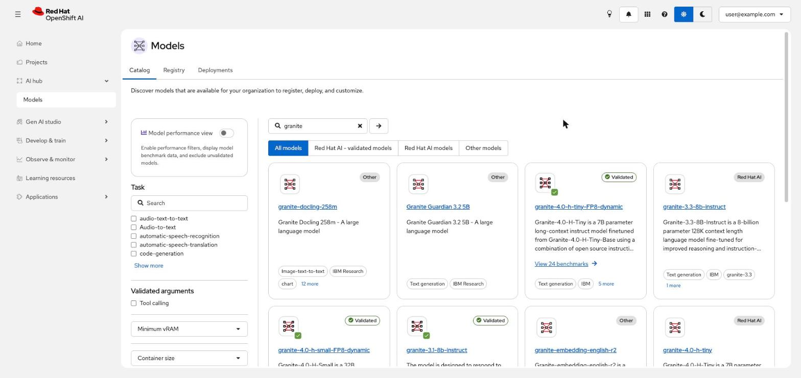

**Projects → your project → Deployments → Deploy model.** Four steps:

1. **Model details:** where the model lives (cluster storage, S3, an OCI registry or a URI) and model type
   **Generative AI model**.

   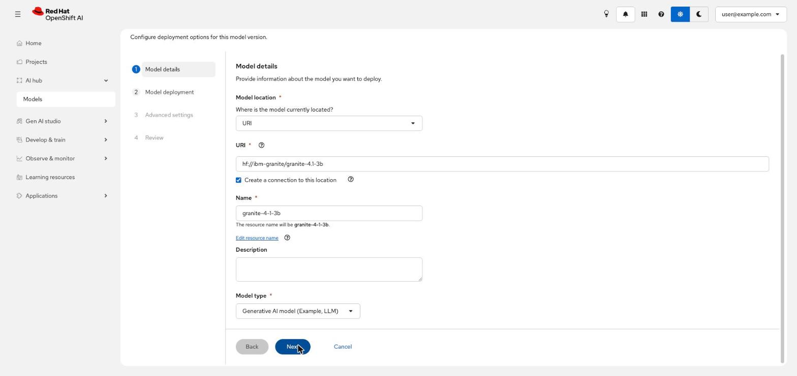

2. **Model deployment:** name, deployment method **LLM inference service with llm-d** (vLLM, with llm-d scheduling)
   and a hardware profile, here a share of one NVIDIA L4.

   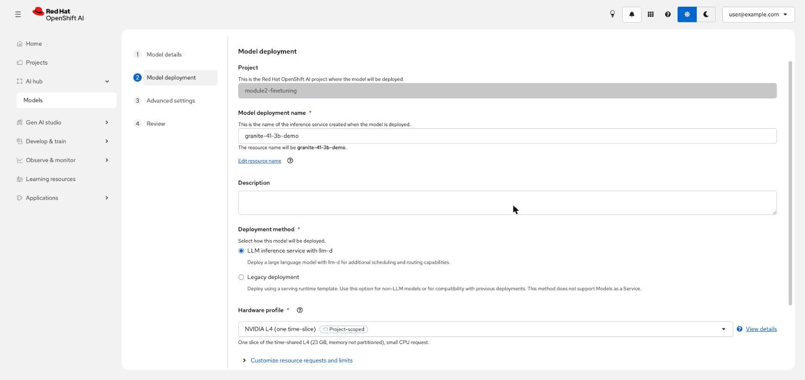

3. **Advanced settings:** external route, token authentication, extra vLLM arguments.
4. **Review**, then **Deploy model**.

We added the LoRA adapters (several fine-tunes on one endpoint) in the YAML, in notebook 04.

## 5. Edge model on llama.cpp

An admin registers llama.cpp once as a serving runtime (**Settings → Serving runtimes → Add serving runtime**, paste
the `ServingRuntime` from notebook 05). After that, anyone in the project deploys a GGUF file with **Deploy model →
Legacy deployment** and that runtime, on a CPU hardware profile.

Both deployments side by side: vLLM with llm-d on a GPU share, and llama.cpp on CPU.

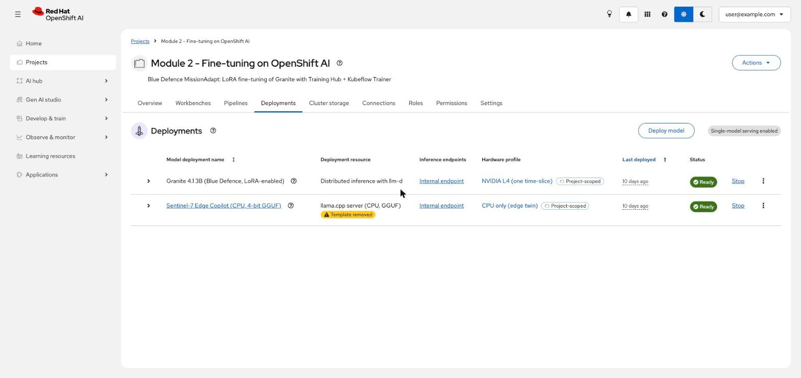

## 6. Try the model (playground, Technology Preview)

**Gen AI studio → Playground** chats with deployed models and compares them side by side. To add a model:
**Deployments → ⋮ → Edit**, tick **Make this deployment available as an AI asset**, save. It then appears under
**Gen AI studio → AI asset endpoints** and in the playground.

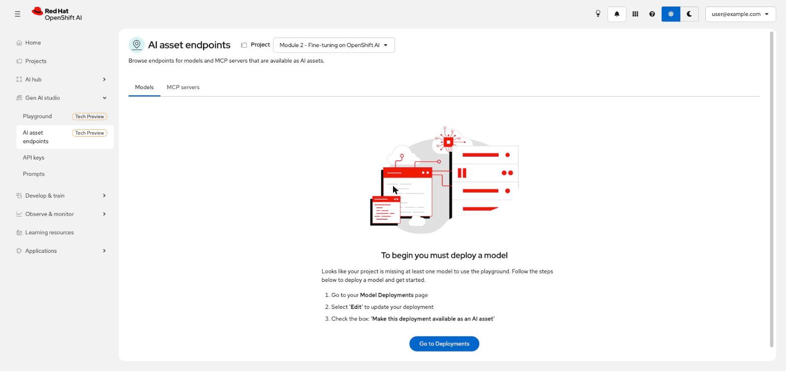

## 7. Gate and promote (pipeline)

Notebook 06 compiles `eval-gate-promote.yaml`. Upload it once with **Develop & train → Pipelines → Pipeline
definitions → Import pipeline**; after that, anyone runs it with **Create run**.

**Develop & train → Pipelines → Runs** shows each run with its status and the metrics it logged (here: 100% exact
reports, 4.3 s average latency).

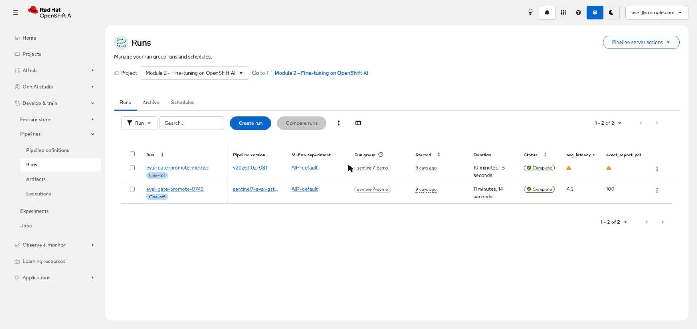

Open a run to see its graph: load held-out notes, evaluate the champion and the challenger in parallel, the quality
gate, then the MLflow record. Click any step for its inputs, outputs and logs.

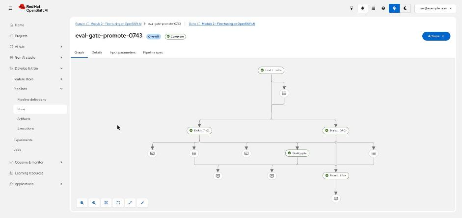

Use **Schedules** to run the gate nightly against the newest challenger.

---

Back to the [README](README.md)
