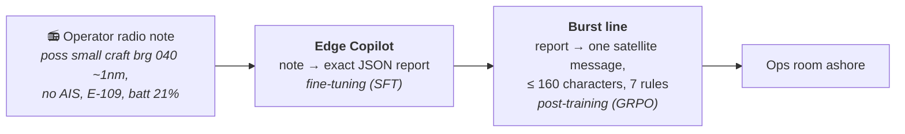
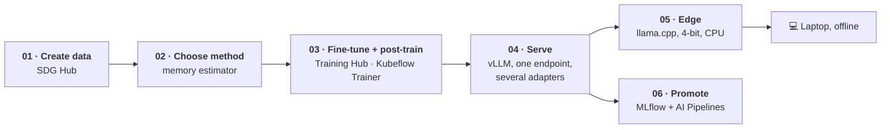
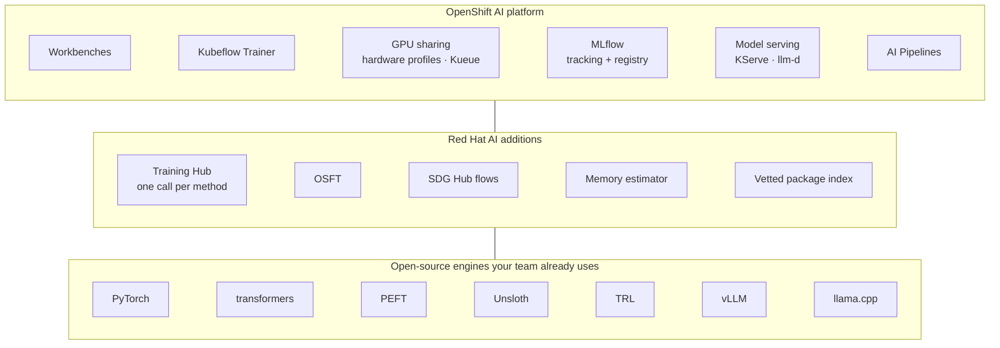
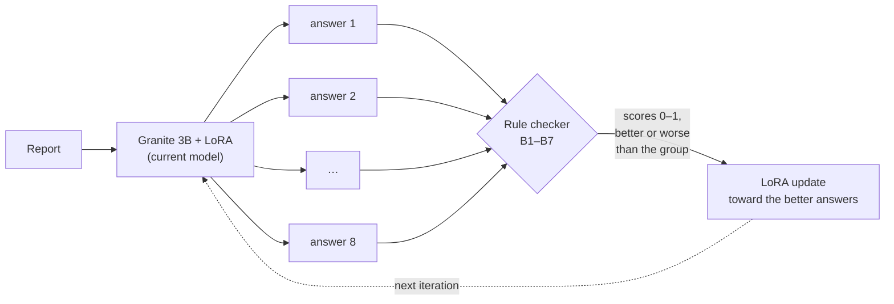
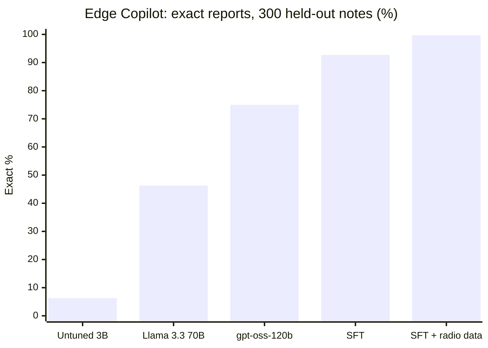
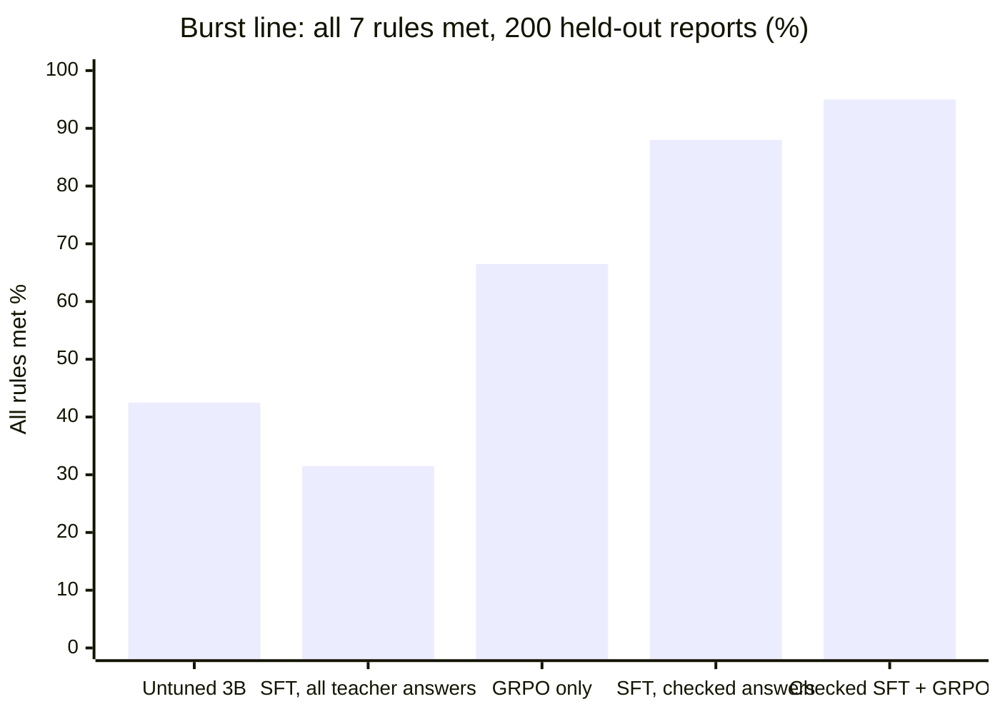

# Sentinel-7: fine-tuning and post-training on Red Hat OpenShift AI

Teach a small open model a specialist job, then run it in production, all in one OpenShift AI project.
Six notebooks take IBM **Granite 4.1-3B** from synthetic data to a served model and an offline edge model, using
**SDG Hub**, **Training Hub**, **Kubeflow Trainer**, **vLLM**, **llama.cpp**, **MLflow** and **AI Pipelines**.

The notebooks use plain library calls (`sdg_hub`, `training_hub`, `kubeflow.trainer`, `kubernetes`, `mlflow`,
`kfp`, `openai`). Nothing to install beyond what the OpenShift AI training workbench image provides, plus
`sdg-hub` and `kfp`, which the notebooks install themselves.

> **Fictional scenario, synthetic data.** Blue Defence runs Sentinel-7 uncrewed patrol vessels. Operators send terse
> radio notes; the ops room needs exact JSON reports, and the shore needs one short satellite message per report.

Built by Nijesh Kanjinghat.

| | |
|---|---|
| **Article** | [How a 3B Model Beat 70B: Fine-tuning and Post-training on Red Hat OpenShift AI →](https://medium.com/@nijesh-kanjinghat/how-a-3b-model-beat-70b-fine-tuning-and-post-training-on-red-hat-openshift-ai-d439782b59c8) The full technical write-up on Medium. |
| **Interactive overview** | [The value of OpenShift AI, step by step →](https://knijesh.github.io/sentinel7-openshift-ai/) |
| **Demo app (replay)** | [Sentinel-7 Ops Console →](https://knijesh.github.io/sentinel7-openshift-ai/console/) Pick a held-out radio note and compare five models side by side: the untuned model, three fine-tuned adapters on vLLM (GPU) and the 4-bit edge model on llama.cpp (CPU). Every answer is real, recorded on Red Hat OpenShift AI. **For the live instance, contact Nijesh Kanjinghat.** |

## The story: one radio note, two jobs

## The workflow, one notebook per step

## What OpenShift AI adds on top of the open-source tools you know

## How post-training with GRPO works here

The same rule checker does two jobs: it filters the teacher's examples for SFT, then scores every answer during GRPO.

## The notebooks

| # | Notebook | What it shows | GPU |
|---|---|---|---|
| 01 | [SDG Hub](notebooks/01_sdg_hub.ipynb) | Synthetic data: a teacher model writes examples through an SDG Hub flow, a rule checker keeps the good ones | none |
| 02 | [Choose a method](notebooks/02_choose_method.ipynb) | Training Hub's memory estimator; LoRA vs OSFT vs full SFT; pick the method by the mistake | none |
| 03 | [Train with Training Hub](notebooks/03_train_lora.ipynb) | `lora_sft` in the notebook, then the same call as a Kubeflow TrainJob; `lora_grpo` with the rule checker as reward | 1 |
| 04 | [Serve on vLLM](notebooks/04_serve_vllm.ipynb) | Base model and several LoRA adapters on one managed endpoint; before vs after on held-out data | 1 |
| 05 | [Edge with llama.cpp](notebooks/05_edge_llamacpp.ipynb) | Merge, 4-bit GGUF, llama.cpp as a serving runtime on CPU, then the same file on a laptop, offline | none |
| 06 | [Gate and promote](notebooks/06_gate_promote.ipynb) | MLflow model registry; a pipeline that promotes a challenger only if it is better | none |

Run them in order: each one uses what the previous one left on the project volume.

## Results we measured

| Use case | Before | After |
|---|---|---|
| Edge Copilot: radio note → exact JSON report (300 held-out notes) | 6.3% exact, untuned, 1,449-token prompt | **99.7–100%**, LoRA SFT, 94-token prompt |
| Same model, 4-bit GGUF on a laptop CPU (first 100 notes) | | **97%**, nothing invented |
| Burst line: report → one message meeting 7 rules (200 held-out reports) | 42.5%, untuned | **95.0%**, checked SFT + GRPO |

For reference, Llama 3.3 70B and gpt-oss-120b, with the full 1,449-token prompt, reached 46.3% and 75.0% exact reports.

## Before you start

1. **An OpenShift AI 3.5 project** with a GPU hardware profile. About 10 GB of GPU memory (a share of one NVIDIA L4)
   is enough for LoRA on Granite 4.1-3B; GRPO needs 24 GB or more (we used 48 GB).
2. **One-time setup**, as a project admin: `envsubst < deploy/00-project-setup.yaml | oc apply -n <project> -f -`
   (project volume, MLflow access, workbench permissions). A cluster admin also grants `training-edit` in the
   project, so notebooks can start TrainJobs; the command is in that file.
3. **A workbench** with the image *Training | Jupyter | PyTorch | Python* (Training Hub, the Kubeflow SDK, MLflow
   and TRL preinstalled). Attach the `workspace` volume at `/opt/app-root/src/workspace`, enable MLflow for the
   project, and clone this repository into the workbench.
4. **Optional:** a teacher model for notebook 01 (any OpenAI-compatible endpoint). Without one, the notebook uses the
   teacher answers in `data/burst/`.

With **ReadWriteOnce** storage, set `NODE_SELECTOR` in the settings cell so every pod that mounts the volume runs on
one node.

## Repository layout

| Path | What |
|---|---|
| `notebooks/` | The six notebooks |
| `data/edgecopilot/` | Radio notes with their exact reports: train 2,400 (+600 radio-style in `train-v2`), val 150, test 300 |
| `data/burst/` | Reports and priorities for the burst line: train 400, val 100, test 200; teacher answers (all, and checker-approved) |
| `sdg_flows/burst_teacher/` | The SDG Hub flow (YAML) and its prompt |
| `deploy/00-project-setup.yaml` | One-time project setup |

## Learn more

- [Training Hub](https://github.com/Red-Hat-AI-Innovation-Team/training_hub) and [SDG Hub](https://github.com/Red-Hat-AI-Innovation-Team/sdg_hub) (Red Hat AI Innovation)
- [Red Hat AI fine-tuning examples](https://github.com/red-hat-data-services/red-hat-ai-examples/tree/main/examples/fine-tuning)
- [OSFT explained](https://developers.redhat.com/articles/2026/07/28/osft-explained-prevent-catastrophic-forgetting-llm-fine-tuning) ·
  [Scale fine-tuning with Training Hub](https://developers.redhat.com/articles/2026/03/26/scale-llm-fine-tuning-training-hub-and-openshift-ai) ·
  [GRPO with verifiable rewards](https://developers.redhat.com/articles/2026/08/26/reinforcement-learning-from-verifiable-rewards-with-training-hub-on-red-hat-openshift-ai)
